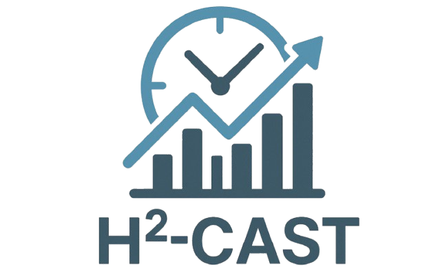
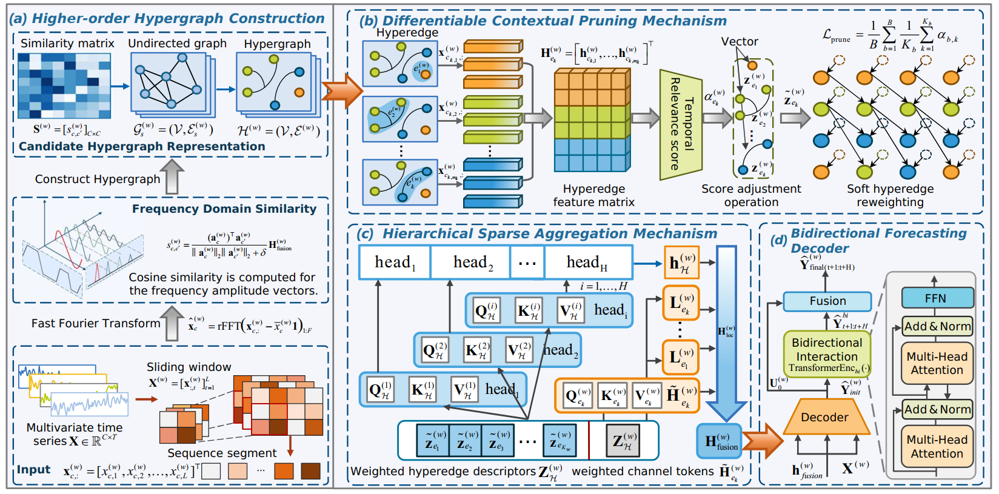
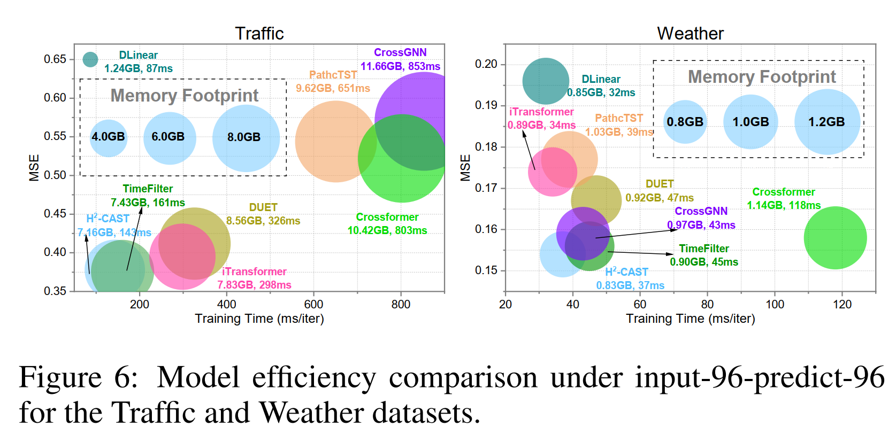

<p align="center">
  
</p>

# H²-CAST: Hierarchical Channel Hypergraph Learning with Context Adaptation for Multivariate Time Series Forecasting

## News

- 2026-07-01: H²-CAST has moved into the next stage, and we are looking forward to good news.

## Overview

**H²-CAST** is a **H**ierarchical **H**ypergraph **C**ausal **A**daptive **S**parse **T**ransformer that introduces a new Channel Hypergraph (CH) perspective. The overall architecture consists of four main components: (a) Higher-order Hypergraph Construction, (b) Differentiable Contextual Pruning Mechanism, (c) Hierarchical Sparse Aggregation Mechanism, and (d) Bidirectional Forecasting Decoder. Our work offers a novel perspective and a practical methodology for modeling complex inter-channel dependencies in Multivariate Time Series Forecasting.



## Main Results

### Long-term Forecasting


### Short-term Forecasting


### Model Efficiency



## Prerequisites

We recommend Python 3.9.24. Install the required dependencies with:

```bash
pip install -r requirements.txt
```

## Prepare Datasets

Download the benchmark datasets provided by the iTransformer repository. Create a `./data` directory and arrange the files as follows:

```text
data/
├── electricity.csv
├── ETTh1.csv
├── ETTh2.csv
├── ETTm1.csv
├── ETTm2.csv
├── Exchange.csv
├── PEMS03.npz
├── PEMS04.npz
├── PEMS07.npz
├── PEMS08.npz
├── solar_AL.txt
├── traffic.csv
└── weather.csv
```

## Architecture Overview

```text
HHCAST-main/
├── run.py                          # Main training and evaluation script
├── data/                           # Benchmark datasets
├── data_provider/                  # Data pipeline
│   ├── data_factory.py
│   └── data_loader.py
├── exp/                            # Experiment definitions
│   ├── exp_basic.py
│   └── exp_long_term_forecasting.py
├── models/
│   ├── HHCAST.py                   # H²-CAST model entrypoint
│   └── hhcast/                     # H²-CAST internal modules
│       ├── __init__.py
│       ├── components.py
│       ├── decoder.py
│       ├── embedding.py
│       ├── model.py
│       └── normalization.py
├── scripts/
│   └── long-term-forecasting/
│       └── ETTh1.sh                # Released main experiment script
│   
└── utils/
    ├── metrics.py
    ├── print_args.py
    ├── timefeatures.py
    └── tools.py
```

## Training

The currently released script reproduces the main H²-CAST experiment on ETTh1 with an input length of 96 and prediction lengths of 96, 192, 336, and 720:

```bash
bash scripts/long-term-forecasting/ETTh1.sh
```

After training finishes:

- Model checkpoints are stored in `./checkpoints`.
- Numerical outputs in `.npy` format are written to `./results`.
- Aggregated metrics are appended to `./result_long_term_forecast.txt`.

At this stage, only the representative ETTh1 main-experiment script is publicly provided. The remaining dataset-specific main experiments, short-term forecasting experiments will be released after the paper is formally accepted.

## Code References

To support reproducibility, this project refers to publicly available implementations from the following repositories:

1. Liu Y, Hu T, Zhang H, et al. *iTransformer: Inverted Transformers Are Effective for Time Series Forecasting*. ICLR, 2024.
2. Wang Y, Wu H, Dong J, et al. *Deep Time Series Models: A Comprehensive Survey and Benchmark*. arXiv:2407.13278, 2024.
3. Hu Y, Zhang G, Liu P, et al. *TimeFilter: Patch-specific Spatial-Temporal Graph Filtration for Time Series Forecasting*. ICML, 2025.
4. Qiu X, Wu X, Lin Y, et al. *DUET: Dual Clustering Enhanced Multivariate Time Series Forecasting*. KDD, 2024.
5. Yan H, Chen D, Jiang G, et al. *DGraFormer: Dynamic Graph Learning Guided Multi-Scale Transformer for Multivariate Time Series Forecasting*. IJCAI, 2025.
6. Cai W, Liang Y, Liu X, et al. *MSGNet: Learning Multi-Scale Inter-Series Correlations for Multivariate Time Series Forecasting*. AAAI, 2024.
7. Chen J, Lenssen J E, Feng A, et al. *From Similarity to Superiority: Channel Clustering for Time Series Forecasting*. NeurIPS, 2024.
